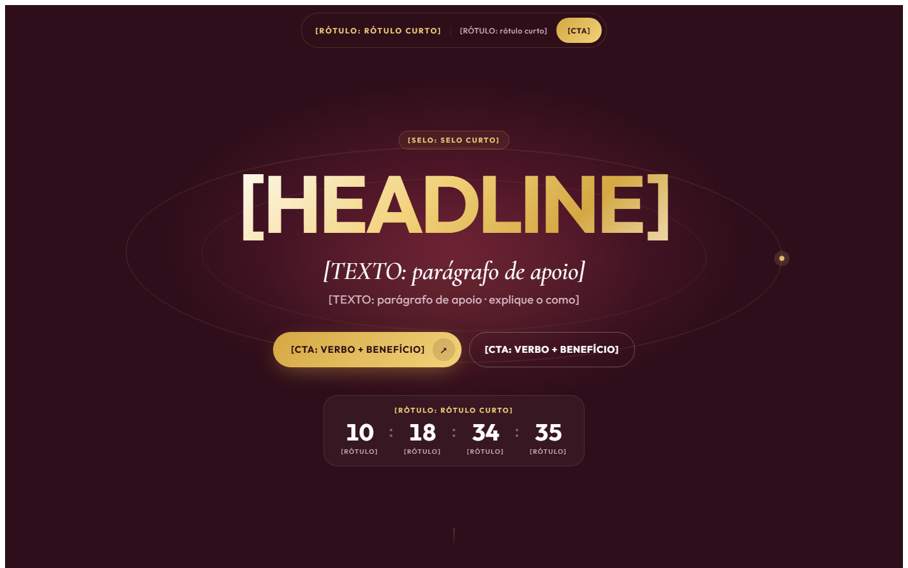

# Captura de evento/live, escuro, com contagem

**Tipo:** Captura / inscrição em evento online.

**Para que serve:** Meditação guiada, aula ao vivo, workshop, encontro: uma página que vende a participação em data marcada, com contagem regressiva e blocos alternando fundo escuro e claro.

## Ordem das seções (cada uma marcada por um comentário numerado no HTML)

1. Barra do topo: nome, data e botão participar.
2. Hero: promessa, dois CTAs e contagem regressiva (os números são estáticos: ligue um script se quiser contagem viva).
3. O que é / quebra de conceito (fundo claro).
4. Virada: por que agora (escuro, com CTA).
5. Como funciona: camadas ou etapas (claro).
6. Caminho / programa (escuro).
7. Preparação / bônus (claro).
8. Inscrição: oferta, preço e botão (escuro).
9. Rodapé: suporte por WhatsApp e legal.

## O que trocar

- **Cores e fontes:** só o bloco `:root` no topo do `<style>` (`--cor-fundo`, `--cor-texto`, `--cor-acento`, `--cor-acento-2`, `--fonte-titulo`, `--fonte-texto` e os extras listados ali). O resto do CSS lê dessas variáveis. Fonte nova entra pelo `<link>` do Google Fonts no `<head>` (ou `@font-face` local do cliente).
- **Texto:** todo `[ROTULO: dica]` é um espaço de copy. O rótulo diz o papel do bloco, a dica diz o que escrever. Escreva a copy pela skill de copy do repositório e pelas réguas da árvore ESCRITA; o molde dá estrutura, não texto.
- **Imagens:** `assets/ph-*.svg` são placeholders com a proporção no rótulo. Troque o `src` pela imagem do cliente (mesma proporção) e o `alt` por descrição real.
- **Links:** `{{LINK_CTA}}`, `{{LINK_WHATSAPP}}`, `{{LINK_PRIVACIDADE}}`, `{{LINK_TERMOS}}` e `{{FORM_ACTION}}` viram a URL real (busque `{{` no arquivo). `href="#"` é link a decidir.
- **Título da página:** `<title>` e a meta description (não existe no molde, acrescente) são do cliente.
- **Rastreio, checkout e formulário:** o molde não traz nada disso. Pixel, GTM, checkout e o destino do formulário entram por decisão da conta, nunca copiados de outra página.
- O botão final aponta para `{{LINK_CTA}}` (checkout/inscrição do cliente).
- Variáveis extras de marca: `--cor-acento-claro`, `--cor-card`, `--cor-fundo-claro`, `--cor-tinta` (texto sobre fundo claro).

## O que NÃO quebrar

- As classes `lx-*` (escopo do CSS) e as seções `.lx-dk` (escura) e `.lx-lt` (clara): a alternância é o ritmo da página.
- Os nomes de classe e `id` que o JavaScript lê (estão no `<script>` no fim do arquivo). Mudar o nome sem mudar o script derruba a interação.
- As proporções das imagens e o `viewport` (a página é responsiva: confira no celular antes de entregar).
- Cada bloco tem comentário numerado: apagar a seção inteira é permitido; deixar o bloco pela metade, não.

## Como abrir

Abra `index.html` direto no navegador (funciona em `file://`, sem build). Prévias: `previa.png` (1440×900) e `previa-celular.png` (500×844; o Chrome headless não renderiza abaixo de 500 px, o layout de 390 px é o mesmo).
