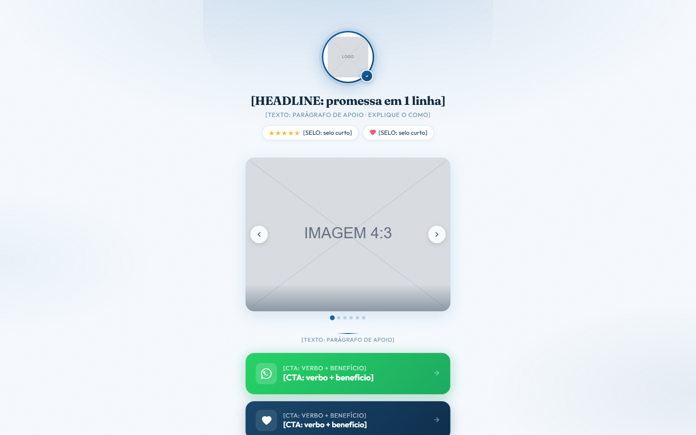

# Link na bio, claro, com carrossel e botões

**Tipo:** Link na bio / cartão de contatos.

**Para que serve:** Perfil de negócio local ou institucional que precisa de uma única página com prova rápida e os caminhos de contato (WhatsApp, ligar, rota, vagas). Mobile primeiro, abre em uma tela.

## Ordem das seções (cada uma marcada por um comentário numerado no HTML)

1. Cabeçalho: avatar/logo, nome, linha de apoio, selos de prova (nota, anos de casa).
2. Carrossel de fotos (6 slides, arrasta e tem pontos).
3. Lista de links-botão, um por destino: WhatsApp (verde), ação principal, rota, redes.
4. Rodapé com assinatura.

## O que trocar

- **Cores e fontes:** só o bloco `:root` no topo do `<style>` (`--cor-fundo`, `--cor-texto`, `--cor-acento`, `--cor-acento-2`, `--fonte-titulo`, `--fonte-texto` e os extras listados ali). O resto do CSS lê dessas variáveis. Fonte nova entra pelo `<link>` do Google Fonts no `<head>` (ou `@font-face` local do cliente).
- **Texto:** todo `[ROTULO: dica]` é um espaço de copy. O rótulo diz o papel do bloco, a dica diz o que escrever. Escreva a copy pela skill de copy do repositório e pelas réguas da árvore ESCRITA; o molde dá estrutura, não texto.
- **Imagens:** `assets/ph-*.svg` são placeholders com a proporção no rótulo. Troque o `src` pela imagem do cliente (mesma proporção) e o `alt` por descrição real.
- **Links:** `{{LINK_CTA}}`, `{{LINK_WHATSAPP}}`, `{{LINK_PRIVACIDADE}}`, `{{LINK_TERMOS}}` e `{{FORM_ACTION}}` viram a URL real (busque `{{` no arquivo). `href="#"` é link a decidir.
- **Título da página:** `<title>` e a meta description (não existe no molde, acrescente) são do cliente.
- **Rastreio, checkout e formulário:** o molde não traz nada disso. Pixel, GTM, checkout e o destino do formulário entram por decisão da conta, nunca copiados de outra página.
- Para um botão a mais, duplique um `<a class="btn ...">` inteiro e ajuste o ícone.

## O que NÃO quebrar

- `#carouselTrack`, `#carouselWrap`, `#carouselDots` e as classes `.carousel-*`: o carrossel depende delas.
- Os nomes de classe e `id` que o JavaScript lê (estão no `<script>` no fim do arquivo). Mudar o nome sem mudar o script derruba a interação.
- As proporções das imagens e o `viewport` (a página é responsiva: confira no celular antes de entregar).
- Cada bloco tem comentário numerado: apagar a seção inteira é permitido; deixar o bloco pela metade, não.

## Como abrir

Abra `index.html` direto no navegador (funciona em `file://`, sem build). Prévias: `previa.png` (1440×900) e `previa-celular.png` (500×844; o Chrome headless não renderiza abaixo de 500 px, o layout de 390 px é o mesmo).
