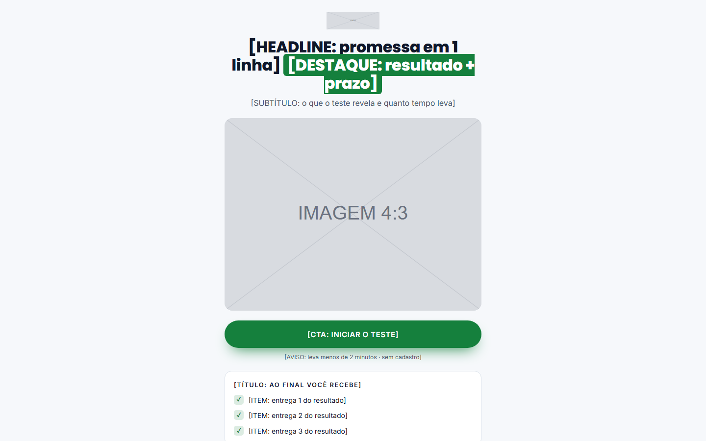

# Quiz em passos, claro, com resultado e CTA

**Tipo:** Quiz.

**Para que serve:** Quiz de diagnóstico: introdução com promessa, perguntas uma por vez com barra de progresso, captura opcional (nome e WhatsApp) e resultado por perfil com CTA da oferta. 100% em um arquivo, sem backend.

## Ordem das seções (cada uma marcada por um comentário numerado no HTML)

1. Introdução: promessa, capa, botão iniciar e "o que você recebe".
2. Perguntas (uma por tela, barra de progresso).
3. Captura opcional (liga/desliga em `PEDIR_CONTATO`).
4. Resultado: perfil, diagnóstico, CTA.

## O que trocar

- **Cores e fontes:** só o bloco `:root` no topo do `<style>` (`--cor-fundo`, `--cor-texto`, `--cor-acento`, `--cor-acento-2`, `--fonte-titulo`, `--fonte-texto` e os extras listados ali). O resto do CSS lê dessas variáveis. Fonte nova entra pelo `<link>` do Google Fonts no `<head>` (ou `@font-face` local do cliente).
- **Texto:** todo `[ROTULO: dica]` é um espaço de copy. O rótulo diz o papel do bloco, a dica diz o que escrever. Escreva a copy pela skill de copy do repositório e pelas réguas da árvore ESCRITA; o molde dá estrutura, não texto.
- **Imagens:** `assets/ph-*.svg` são placeholders com a proporção no rótulo. Troque o `src` pela imagem do cliente (mesma proporção) e o `alt` por descrição real.
- **Links:** `{{LINK_CTA}}`, `{{LINK_WHATSAPP}}`, `{{LINK_PRIVACIDADE}}`, `{{LINK_TERMOS}}` e `{{FORM_ACTION}}` viram a URL real (busque `{{` no arquivo). `href="#"` é link a decidir.
- **Título da página:** `<title>` e a meta description (não existe no molde, acrescente) são do cliente.
- **Rastreio, checkout e formulário:** o molde não traz nada disso. Pixel, GTM, checkout e o destino do formulário entram por decisão da conta, nunca copiados de outra página.
- **Perguntas, opções e resultados ficam no topo do `<script>` (`PERGUNTAS`, `RESULTADOS`).** Cada opção soma um ponto ao perfil `a`, `b` ou `c`; o maior define o resultado. Para mais perfis, acrescente a letra em `pontos` e em `RESULTADOS`.
- Com backend, apague o handler do `submit` e deixe o formulário postar para `{{FORM_ACTION}}`.

## O que NÃO quebrar

- Os ids `t-intro`, `t-quiz`, `t-captura`, `t-resultado`, `btn-iniciar`, `btn-prox` e a classe `.tela.on`.
- Os nomes de classe e `id` que o JavaScript lê (estão no `<script>` no fim do arquivo). Mudar o nome sem mudar o script derruba a interação.
- As proporções das imagens e o `viewport` (a página é responsiva: confira no celular antes de entregar).
- Cada bloco tem comentário numerado: apagar a seção inteira é permitido; deixar o bloco pela metade, não.

## Como abrir

Abra `index.html` direto no navegador (funciona em `file://`, sem build). Prévias: `previa.png` (1440×900) e `previa-celular.png` (500×844; o Chrome headless não renderiza abaixo de 500 px, o layout de 390 px é o mesmo).
