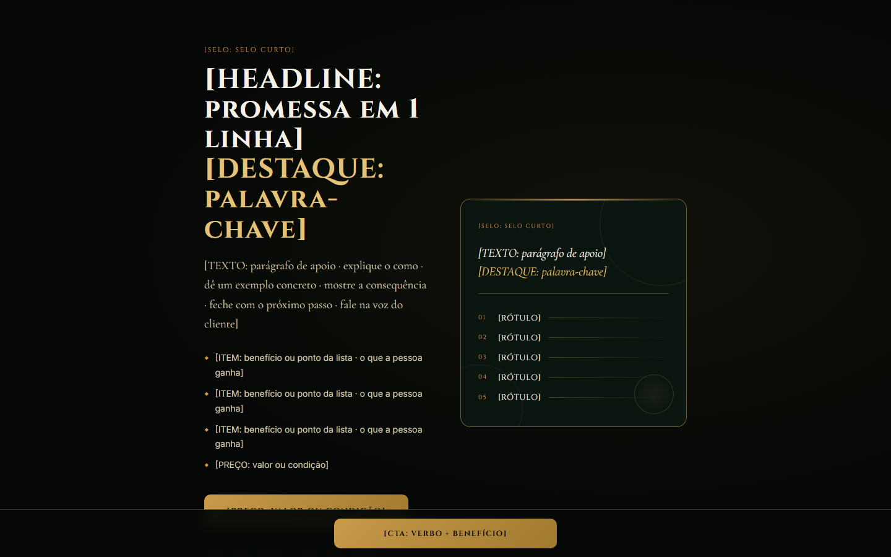

# Vendas curta de produto de entrada, escura e dourada

**Tipo:** Página de vendas curta (produto de entrada).

**Para que serve:** Produto digital de ticket baixo (introdução, mini-curso, e-book curto): identifica a dor, reenquadra, apresenta o método, a oferta e responde as dúvidas em 16 blocos enxutos, com CTA fixo no rodapé da tela.

## Ordem das seções (cada uma marcada por um comentário numerado no HTML)

1. Hero: promessa, benefícios, CTA e cartão-resumo do método.
2. Identificação.
3. Consequência.
4. Reenquadre.
5. Causa real.
6. Método.
7. Etapas do método (5 cartões).
8. Antes × depois.
9. Conteúdo.
10. Para quem é.
11. Por que agora.
12. Oferta: o que recebe, preço, CTA.
13. Pós-compra.
14. Tranquilidade (garantia).
15. FAQ em acordeão.
16. CTA final.

## O que trocar

- **Cores e fontes:** só o bloco `:root` no topo do `<style>` (`--cor-fundo`, `--cor-texto`, `--cor-acento`, `--cor-acento-2`, `--fonte-titulo`, `--fonte-texto` e os extras listados ali). O resto do CSS lê dessas variáveis. Fonte nova entra pelo `<link>` do Google Fonts no `<head>` (ou `@font-face` local do cliente).
- **Texto:** todo `[ROTULO: dica]` é um espaço de copy. O rótulo diz o papel do bloco, a dica diz o que escrever. Escreva a copy pela skill de copy do repositório e pelas réguas da árvore ESCRITA; o molde dá estrutura, não texto.
- **Imagens:** `assets/ph-*.svg` são placeholders com a proporção no rótulo. Troque o `src` pela imagem do cliente (mesma proporção) e o `alt` por descrição real.
- **Links:** `{{LINK_CTA}}`, `{{LINK_WHATSAPP}}`, `{{LINK_PRIVACIDADE}}`, `{{LINK_TERMOS}}` e `{{FORM_ACTION}}` viram a URL real (busque `{{` no arquivo). `href="#"` é link a decidir.
- **Título da página:** `<title>` e a meta description (não existe no molde, acrescente) são do cliente.
- **Rastreio, checkout e formulário:** o molde não traz nada disso. Pixel, GTM, checkout e o destino do formulário entram por decisão da conta, nunca copiados de outra página.
- O CTA fixo no pé da tela (`#stickyCta`) some na seção de oferta e depois troca o link para o checkout: ajuste a constante `checkout` no `<script>` (vem como `{{LINK_CTA}}`).

## O que NÃO quebrar

- `#oferta`, `#stickyCta`, `#stickyBtn` e `.faq-item/.faq-btn`: o script do CTA fixo e do FAQ lê esses nomes.
- Os nomes de classe e `id` que o JavaScript lê (estão no `<script>` no fim do arquivo). Mudar o nome sem mudar o script derruba a interação.
- As proporções das imagens e o `viewport` (a página é responsiva: confira no celular antes de entregar).
- Cada bloco tem comentário numerado: apagar a seção inteira é permitido; deixar o bloco pela metade, não.

## Como abrir

Abra `index.html` direto no navegador (funciona em `file://`, sem build). Prévias: `previa.png` (1440×900) e `previa-celular.png` (500×844; o Chrome headless não renderiza abaixo de 500 px, o layout de 390 px é o mesmo).
