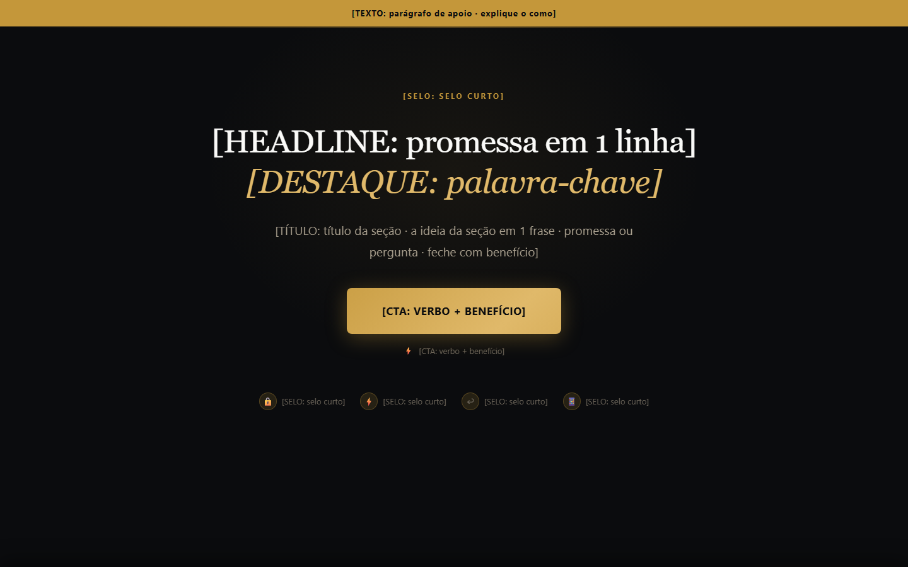

# Vendas longa de treinamento, escura e dourada

**Tipo:** Página de vendas longa.

**Para que serve:** Treinamento ou método de ticket médio: identificação, diagnóstico, custo da inação, revelação, mecanismo, módulos, resultados, depoimentos, reenquadre, oferta com pilha de valor, garantia e FAQ. Revela cada bloco ao rolar.

## Ordem das seções (cada uma marcada por um comentário numerado no HTML)

1. Hero.
2. Identificação.
3. Diagnóstico (4 cartões).
4. Custo da inação (números).
5. Revelação (citação).
6. Mecanismo (3 passos).
7. Módulos / conteúdo.
8. Resultados (possibilidades, não promessa de ganho).
9. Depoimentos.
10. Reenquadre.
11. Oferta (pilha de valor, preço, CTA).
12. Garantia.
13. Transição.
14. FAQ.
15. CTA final.
16. Rodapé legal.

## O que trocar

- **Cores e fontes:** só o bloco `:root` no topo do `<style>` (`--cor-fundo`, `--cor-texto`, `--cor-acento`, `--cor-acento-2`, `--fonte-titulo`, `--fonte-texto` e os extras listados ali). O resto do CSS lê dessas variáveis. Fonte nova entra pelo `<link>` do Google Fonts no `<head>` (ou `@font-face` local do cliente).
- **Texto:** todo `[ROTULO: dica]` é um espaço de copy. O rótulo diz o papel do bloco, a dica diz o que escrever. Escreva a copy pela skill de copy do repositório e pelas réguas da árvore ESCRITA; o molde dá estrutura, não texto.
- **Imagens:** `assets/ph-*.svg` são placeholders com a proporção no rótulo. Troque o `src` pela imagem do cliente (mesma proporção) e o `alt` por descrição real.
- **Links:** `{{LINK_CTA}}`, `{{LINK_WHATSAPP}}`, `{{LINK_PRIVACIDADE}}`, `{{LINK_TERMOS}}` e `{{FORM_ACTION}}` viram a URL real (busque `{{` no arquivo). `href="#"` é link a decidir.
- **Título da página:** `<title>` e a meta description (não existe no molde, acrescente) são do cliente.
- **Rastreio, checkout e formulário:** o molde não traz nada disso. Pixel, GTM, checkout e o destino do formulário entram por decisão da conta, nunca copiados de outra página.
- Os números do bloco "custo da inação" e "resultados" só entram com fonte `D` da conta (régua de procedência da árvore ESCRITA).

## O que NÃO quebrar

- `.reveal` / `.is-visible` (revelação ao rolar), `#faqList`, `.faq__*` e `#hero` (o CTA fixo observa o hero).
- Os nomes de classe e `id` que o JavaScript lê (estão no `<script>` no fim do arquivo). Mudar o nome sem mudar o script derruba a interação.
- As proporções das imagens e o `viewport` (a página é responsiva: confira no celular antes de entregar).
- Cada bloco tem comentário numerado: apagar a seção inteira é permitido; deixar o bloco pela metade, não.

## Como abrir

Abra `index.html` direto no navegador (funciona em `file://`, sem build). Prévias: `previa.png` (1440×900) e `previa-celular.png` (500×844; o Chrome headless não renderiza abaixo de 500 px, o layout de 390 px é o mesmo).
