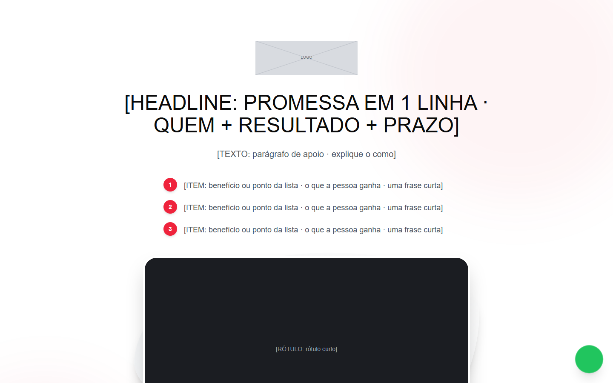

# VSL + vendas longa, clara, com modal de captura

**Tipo:** Página de VSL (vídeo + CTA) com vendas longa abaixo.

**Para que serve:** Aula gratuita em vídeo no topo, três bullets do que a pessoa vai aprender, e abaixo a página de vendas completa (prova, identificação, método, efeitos, depoimentos, oferta, FAQ). Todo CTA abre um modal que pede nome, e-mail e WhatsApp antes de seguir.

## Ordem das seções (cada uma marcada por um comentário numerado no HTML)

1. Hero: headline, bullets, vídeo e CTA.
2. Prova em prints (galeria 9:16).
3. Identificação.
4. Virada (bloco escuro).
5. Método / protocolo.
6. Por que o que tentou não funcionou (2 colunas).
7. Efeitos (3 colunas).
8. Depoimentos em cartões.
9. Oferta (abre o modal).
10. Para quem é.
11. Autora.
12. CTA final.
13. FAQ.
14. Rodapé legal.

## O que trocar

- **Cores e fontes:** só o bloco `:root` no topo do `<style>` (`--cor-fundo`, `--cor-texto`, `--cor-acento`, `--cor-acento-2`, `--fonte-titulo`, `--fonte-texto` e os extras listados ali). O resto do CSS lê dessas variáveis. Fonte nova entra pelo `<link>` do Google Fonts no `<head>` (ou `@font-face` local do cliente).
- **Texto:** todo `[ROTULO: dica]` é um espaço de copy. O rótulo diz o papel do bloco, a dica diz o que escrever. Escreva a copy pela skill de copy do repositório e pelas réguas da árvore ESCRITA; o molde dá estrutura, não texto.
- **Imagens:** `assets/ph-*.svg` são placeholders com a proporção no rótulo. Troque o `src` pela imagem do cliente (mesma proporção) e o `alt` por descrição real.
- **Links:** `{{LINK_CTA}}`, `{{LINK_WHATSAPP}}`, `{{LINK_PRIVACIDADE}}`, `{{LINK_TERMOS}}` e `{{FORM_ACTION}}` viram a URL real (busque `{{` no arquivo). `href="#"` é link a decidir.
- **Título da página:** `<title>` e a meta description (não existe no molde, acrescente) são do cliente.
- **Rastreio, checkout e formulário:** o molde não traz nada disso. Pixel, GTM, checkout e o destino do formulário entram por decisão da conta, nunca copiados de outra página.
- O vídeo é um `[VÍDEO / EMBED 16:9]`: cole o iframe do player no lugar.
- O modal (`#checkout-modal`) tem um `<form action="{{FORM_ACTION}}">`: ligue ao CRM/checkout do cliente.
- Tailwind já compilado dentro do `<style>`: não precisa de build. Para mexer em espaçamento, edite as classes no HTML.
- Os ícones usam Font Awesome por CDN (precisa de internet).

## O que NÃO quebrar

- `openModal()` / `closeModal()` (botões de CTA), `#masonry-gallery`, `.faq-button`, `.faq-content`.
- Os nomes de classe e `id` que o JavaScript lê (estão no `<script>` no fim do arquivo). Mudar o nome sem mudar o script derruba a interação.
- As proporções das imagens e o `viewport` (a página é responsiva: confira no celular antes de entregar).
- Cada bloco tem comentário numerado: apagar a seção inteira é permitido; deixar o bloco pela metade, não.

## Como abrir

Abra `index.html` direto no navegador (funciona em `file://`, sem build). Prévias: `previa.png` (1440×900) e `previa-celular.png` (500×844; o Chrome headless não renderiza abaixo de 500 px, o layout de 390 px é o mesmo).
